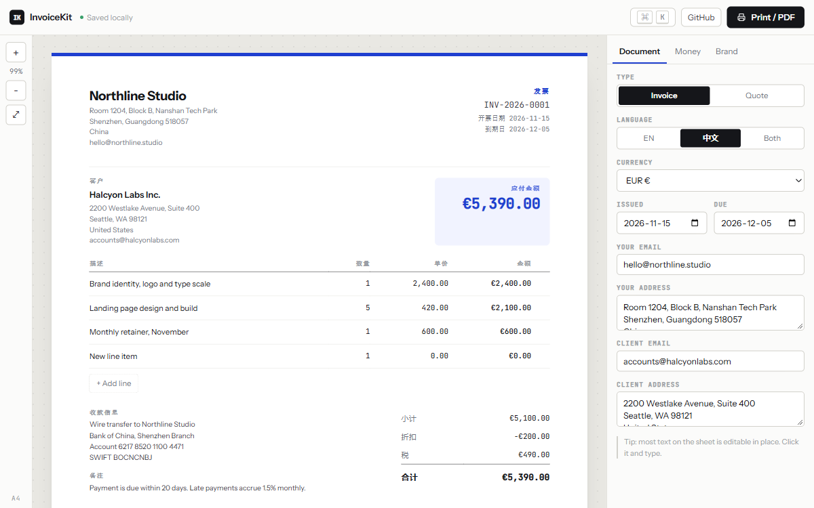

# InvoiceKit

An invoice you edit on the page itself. Click a line, type, print to PDF. Bilingual labels, nine currencies, no account.



**Live demo: https://shiyangh76-max.github.io/invoicekit/**

## What it does

- The A4 sheet is the editor: click any text and type, no form and preview split
- Bilingual labels by default (INVOICE / 发票, Total / 合计), or English or Chinese alone
- Nine currencies with the right symbol and decimal places, JPY included
- Line items with quantity, rate and computed amounts, tax after discount, discount as amount or percentage
- Logo upload by click or drag, four accent colours
- Saves to localStorage as you type, so a reload does not lose the draft
- Prints with the browser PDF engine, which keeps the text selectable
- Command palette and undo

## Run it

```bash
git clone https://github.com/shiyangh76-max/invoicekit.git
cd invoicekit
python -m http.server 8080
```

## Printing

Use Print, then choose "Save as PDF" and set margins to none. The print stylesheet sets an A4 page with 15 mm side margins, so the PDF matches what you see.

## What it does not do

- No currency conversion. The symbol changes, the numbers do not.
- No recurring invoices, no payment links, no e-invoicing XML.
- No server, so no sync between devices. Everything lives in one browser profile.

## Why it exists

Most invoice generators make you fill a form and squint at a small preview. Here the page is the input, which removes the step where you notice the address wrapped badly.

## Feedback

Open an issue with the country you invoice from and what your tax authority expects on the document.

## License

MIT.
